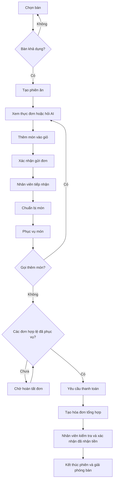
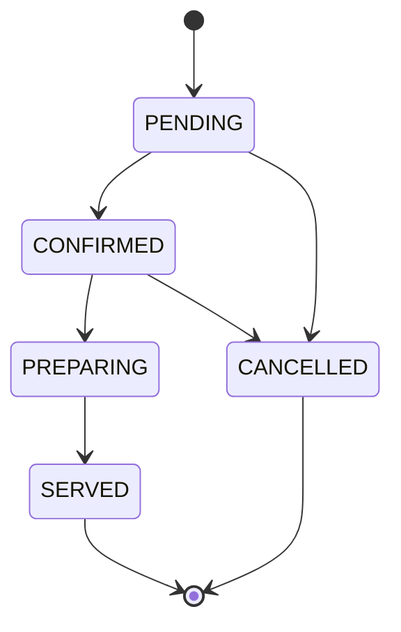
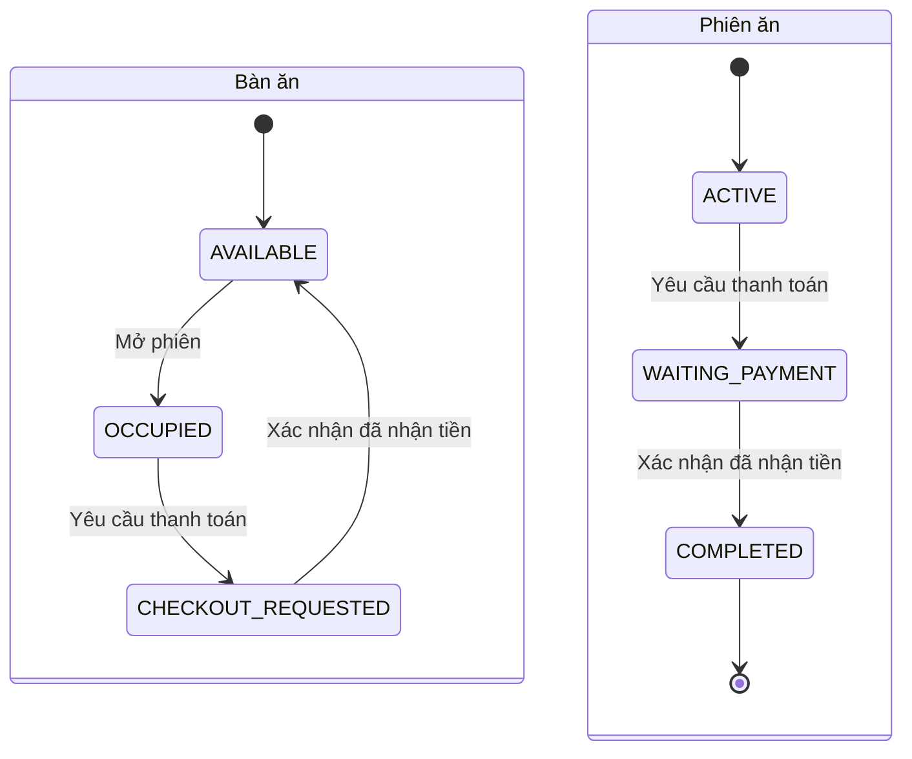
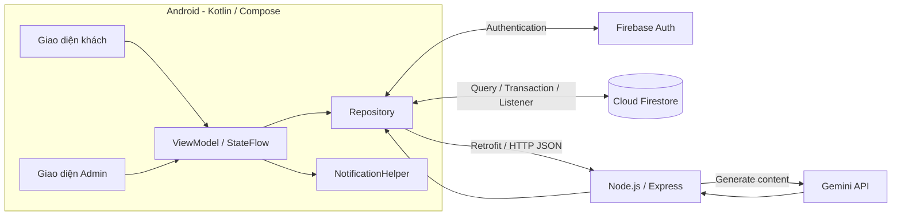
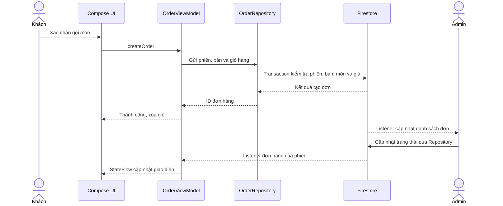
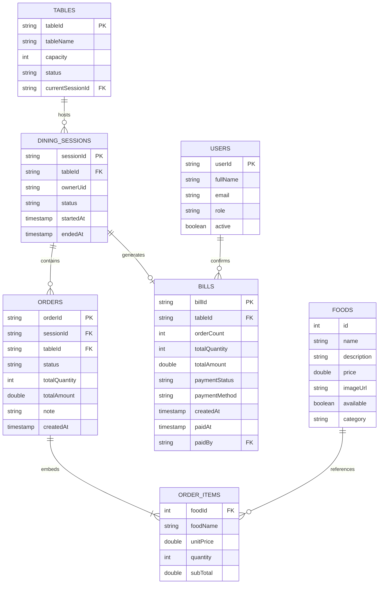
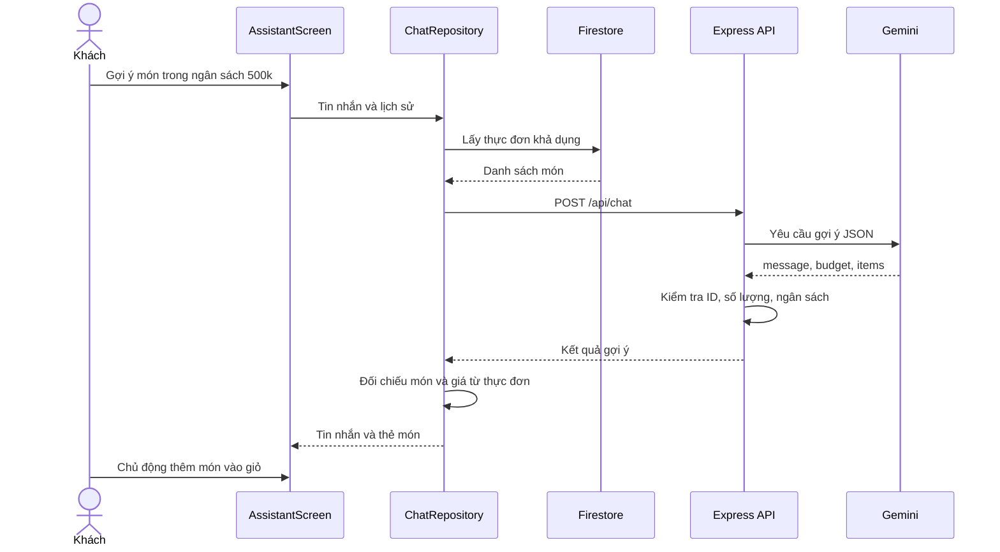

# Foodie — Restaurant Ordering System

Ứng dụng Android hỗ trợ gọi món tại bàn, điều phối đơn hàng và thanh toán tại nhà hàng. Foodie kết nối thiết bị phục vụ khách với bộ phận xử lý đơn thông qua Firebase Firestore, đồng thời cung cấp trợ lý AI gợi ý món ăn dựa trên thực đơn, sở thích và ngân sách.

   

> Phạm vi: MVP phục vụ mô hình ăn tại chỗ, sử dụng thiết bị tại bàn. Thanh toán do nhân viên xác nhận; chưa tích hợp đối soát ngân hàng tự động.

## Mục lục

- [Bài toán và phạm vi](#1-bài-toán-và-phạm-vi)
- [Chức năng](#2-chức-năng)
- [Quy trình nghiệp vụ](#3-quy-trình-nghiệp-vụ)
- [Kiến trúc hệ thống](#4-kiến-trúc-hệ-thống)
- [Thiết kế dữ liệu](#5-thiết-kế-dữ-liệu)
- [Trợ lý AI](#6-trợ-lý-ai)
- [Thông báo và hiệu năng](#7-thông-báo-và-hiệu-năng)
- [Cài đặt và vận hành](#8-cài-đặt-và-vận-hành)
- [Kiểm thử](#9-kiểm-thử)
- [Bảo mật và hướng phát triển](#10-bảo-mật-và-hướng-phát-triển)

## 1. Bài toán và phạm vi

Trong quy trình phục vụ truyền thống, khách cần chờ nhân viên ghi nhận món, nhà bếp tiếp nhận yêu cầu và thu ngân tổng hợp các lượt gọi món trước khi thanh toán. Việc trao đổi thủ công có thể gây nhầm lẫn hoặc chậm cập nhật trạng thái.

Foodie tổ chức toàn bộ lượt gọi món theo **phiên ăn (Dining Session)**. Một bàn có thể phát sinh nhiều đơn trong cùng phiên, nhưng chỉ có một hóa đơn tổng hợp khi kết thúc. Khách chủ động chọn món và theo dõi tiến độ; nhân viên tiếp nhận đơn và xác nhận thanh toán trên giao diện quản trị.

| Vai trò | Trách nhiệm |
| --- | --- |
| Khách / thiết bị tại bàn | Chọn bàn, xem thực đơn, gọi món, theo dõi đơn, yêu cầu thanh toán, sử dụng trợ lý AI |
| Nhân viên / Admin | Tiếp nhận đơn, cập nhật tiến độ phục vụ, xác nhận thanh toán và giải phóng bàn |

Không yêu cầu khách tạo tài khoản cá nhân. Thiết bị khách sử dụng Firebase Anonymous Authentication; nhân viên sử dụng tài khoản được cấp trước.

## 2. Chức năng

### 2.1. Giao diện khách hàng

- Hiển thị danh sách bàn và tình trạng sử dụng; tạo và khôi phục phiên ăn.
- Xem thực đơn theo danh mục, tìm kiếm món, hiển thị hình ảnh và giá.
- Thêm, giảm số lượng món trong giỏ hàng; gửi nhiều lượt gọi món trong một phiên.
- Theo dõi trạng thái đơn hàng theo thời gian thực.
- Yêu cầu thanh toán, xem hóa đơn tổng hợp và kết thúc phiên sau khi nhân viên xác nhận.
- Trò chuyện với trợ lý AI, nhận danh sách món gợi ý và chủ động thêm món vào giỏ.

### 2.2. Giao diện quản trị

- Đăng nhập và kiểm tra vai trò ADMIN.
- Theo dõi danh sách đơn hàng, lọc theo trạng thái và xem chi tiết.
- Xác nhận đơn, cập nhật quá trình chuẩn bị và phục vụ; hủy đơn trong trạng thái cho phép.
- Theo dõi hóa đơn chưa thanh toán, xác nhận tiền mặt hoặc chuyển khoản.

Phạm vi quản trị hiện tại tập trung vào vận hành đơn hàng và thanh toán, không bao gồm quản lý kho, nhân sự, doanh thu hay CRUD thực đơn.

## 3. Quy trình nghiệp vụ

### 3.1. Luồng phục vụ tại bàn



### 3.2. Vòng đời đơn hàng



| Trạng thái | Ý nghĩa |
| --- | --- |
| `PENDING` | Chờ tiếp nhận |
| `CONFIRMED` | Đã xác nhận |
| `PREPARING` | Đang chuẩn bị |
| `SERVED` | Đã phục vụ |
| `CANCELLED` | Đã hủy, không tính vào hóa đơn |

### 3.3. Vòng đời bàn và phiên ăn



`WAITING_PAYMENT` trong sơ đồ là nhãn phân biệt trực quan; giá trị lưu trong Firestore của phiên là `CHECKOUT_REQUESTED`.

### 3.4. Quy tắc nghiệp vụ

- Một bàn chỉ có tối đa một phiên đang hoạt động hoặc chờ thanh toán.
- Giỏ hàng là dữ liệu món chưa gửi; mỗi lần xác nhận tạo một đơn độc lập.
- Giá món được lưu theo thời điểm đặt để thay đổi thực đơn không làm sai lệch lịch sử.
- Chỉ yêu cầu thanh toán khi có ít nhất một đơn đã phục vụ và không còn đơn đang xử lý; đơn hủy không tính tiền.
- Khi đã yêu cầu thanh toán, khách không được gửi thêm đơn.
- Xác nhận thanh toán cập nhật hóa đơn, phiên ăn và bàn trong cùng transaction.

## 4. Kiến trúc hệ thống



Ứng dụng sử dụng MVVM: Compose hiển thị trạng thái và chuyển sự kiện người dùng đến ViewModel; ViewModel quản lý trạng thái bằng StateFlow và Coroutine; Repository thực hiện truy cập dữ liệu. Backend Node.js chỉ phục vụ tính năng AI, không thay thế Firestore trong nghiệp vụ đặt món.

| Thành phần | Công nghệ |
| --- | --- |
| Ngôn ngữ và UI | Kotlin, Jetpack Compose, Material 3 |
| Điều hướng | Navigation Compose |
| Quản lý trạng thái | ViewModel, StateFlow, Kotlin Coroutines |
| Xác thực và dữ liệu | Firebase Authentication, Cloud Firestore |
| HTTP client | Retrofit, OkHttp, Gson |
| Hình ảnh | Coil, URL ảnh từ thực đơn |
| AI backend | Node.js, Express, Gemini API |
| Thông báo | Android Local Notification |

### 4.1. Tổ chức mã nguồn (theo nhóm trách nhiệm)

```text
app/src/main/java/com/example/foodie/
├── MainActivity.kt
├── FoodieNavGraph.kt
├── model/          # Food, Table, DiningSession, Order, Bill, ChatMessage...
├── repository/     # Truy cập Firestore, Auth và API chatbot
├── viewmodel/      # Trạng thái và xử lý sự kiện
├── network/        # Retrofit client, API service, DTO
├── components/     # Thành phần UI dùng chung
├── admin/          # Giao diện quản trị
├── ui/theme/       # Màu sắc và giao diện
└── utils/          # NotificationHelper
```

Các màn hình khách và một số lớp dùng chung nằm tại package gốc. Backend AI là project Node.js riêng; có thể đặt trong thư mục `foodie-ai-server/` khi tổ chức repository.

### 4.2. Luồng gửi đơn và cập nhật trạng thái



## 5. Thiết kế dữ liệu

Cloud Firestore sử dụng collection/document. Sơ đồ ERD dưới đây biểu diễn quan hệ logic, không hàm ý Firestore có khóa ngoại hoặc JOIN như cơ sở dữ liệu quan hệ.



### 5.1. Cấu trúc Firestore

| Collection / document | Nội dung |
| --- | --- |
| `foods/{foodId}` | Thực đơn; ID số của món được lưu trong trường `id` |
| `tables/{tableId}` | Thông tin bàn và tham chiếu phiên hiện tại |
| `dining_sessions/{sessionId}` | Phiên ăn và UID thiết bị sở hữu |
| `orders/{orderId}` | Đơn hàng, tổng tiền, trạng thái và mảng `items` |
| `bills/{sessionId}` | Hóa đơn tổng hợp; ID document trùng ID phiên |
| `users/{uid}` | Hồ sơ và quyền của tài khoản Admin |

Các ID như `tableId`, `sessionId`, `orderId`, `billId`, `userId` của chính document được ánh xạ từ document ID vào model bằng `@DocumentId`, không cần lưu lặp lại. Các trường tham chiếu sang document khác vẫn được lưu. `ORDER_ITEMS` là mảng nhúng, không phải collection độc lập. `ownerUid` tham chiếu Firebase Auth, không yêu cầu hồ sơ khách trong `users`.

### 5.2. Ví dụ document đơn hàng

Dữ liệu minh họa (timestamp được biểu diễn dưới dạng chuỗi để dễ đọc):

```json
{
  "sessionId": "session-demo",
  "tableId": "TABLE01",
  "status": "PENDING",
  "totalQuantity": 2,
  "totalAmount": 300000,
  "note": "",
  "createdAt": "2026-01-01T12:00:00Z",
  "items": [
    {
      "foodId": 1,
      "foodName": "Bò lúc lắc",
      "unitPrice": 150000,
      "quantity": 2,
      "subTotal": 300000
    }
  ]
}
```

### 5.3. Tính nhất quán và lựa chọn thiết kế

- Nhúng chi tiết món trong đơn để đọc đơn và các món cùng lúc, giảm truy vấn riêng. Đổi lại, phải giới hạn kích thước đơn và tuân thủ giới hạn document Firestore.
- Lưu `foodName`, `unitPrice` và `subTotal` như snapshot nghiệp vụ; lưu tổng tiền và số lượng để hiển thị danh sách mà không cần tính lại mọi lần.
- Dùng transaction cho mở phiên, tạo đơn, yêu cầu thanh toán và xác nhận thanh toán.
- Hóa đơn chỉ tổng hợp các đơn đã phục vụ; document ID theo phiên giúp tránh tạo nhiều hóa đơn cho một phiên.

## 6. Trợ lý AI

Trợ lý Foodie tư vấn món ăn bằng tiếng Việt dựa trên thực đơn hiện có, ngân sách, sở thích và lịch sử hội thoại gần nhất. Kết quả được hiển thị bằng thẻ món dùng chung với thực đơn; khách tự quyết định số lượng và thêm vào giỏ hàng.



| Method | Endpoint | Mục đích |
| --- | --- | --- |
| GET | `/health` | Kiểm tra backend đang hoạt động |
| POST | `/api/chat` | Nhận tin nhắn, thực đơn, lịch sử; trả lời và gợi ý món |

Request gồm `message`, `menu`, `history`. Response gồm `message`, `budget` (có thể null), `items` (mỗi phần tử có `foodId`, `quantity`). Backend kiểm tra dữ liệu và Android đối chiếu lại với thực đơn. Ngân sách áp dụng cho nhóm món gợi ý, không phải giới hạn cứng của toàn bộ phiên ăn. AI không tự đặt món hoặc thực hiện thanh toán.

API key được cấu hình tại backend thay vì đóng gói trong APK. Backend hiện phục vụ môi trường debug local, chưa phải dịch vụ AI production.

## 7. Thông báo và hiệu năng

- Tái sử dụng Firestore realtime listener để phát hiện thay đổi trạng thái đơn, đơn mới và yêu cầu/kết quả thanh toán.
- Dùng snapshot đầu tiên làm mốc so sánh, hạn chế thông báo lại dữ liệu cũ.
- Quản lý listener bằng coroutine job; duy trì theo phiên hoặc màn hình quản trị, dừng khi kết thúc phạm vi sử dụng.
- Sử dụng LazyColumn cho danh sách và Coil để tải ảnh; tái sử dụng thành phần giao diện.
- Không dùng polling, không tạo collection thông báo riêng và không chạy foreground service liên tục.

Local Notification yêu cầu quyền trên Android 13 trở lên. Không đảm bảo nhận thông báo khi tiến trình bị hệ điều hành dừng; chưa tích hợp FCM. Việc duy trì listener vẫn phát sinh lượt đọc Firestore khi dữ liệu thay đổi.

## 8. Cài đặt và vận hành

### 8.1. Yêu cầu

- Android Studio, Android SDK phù hợp cấu hình Gradle của project; Android 8.0 (API 26) trở lên theo cấu hình phát triển hiện tại.
- Firebase project riêng, bật Cloud Firestore và Authentication (Anonymous, Email/Password).
- Node.js 20 trở lên nếu sử dụng trợ lý AI; thông tin truy cập Gemini hợp lệ và model khả dụng.

### 8.2. Android và Firebase

1. Clone repository và mở thư mục Android bằng Android Studio.
2. Đăng ký Android app trong Firebase với application ID tương ứng (`com.example.foodie` theo mã nguồn hiện tại).
3. Tải file cấu hình Firebase của môi trường riêng vào `app/google-services.json`.
4. Cấu hình Firestore Security Rules theo quyền khách và Admin; không dùng rules mở toàn bộ dữ liệu.
5. Khởi tạo dữ liệu `foods` và `tables`. Bàn mới có `status = AVAILABLE`, `currentSessionId = null` (giá trị null thực).
6. Tạo tài khoản nhân viên trong Firebase Authentication và document `users/{uid}` với `role = ADMIN`, `active = true`, `fullName`, `email`.
7. Đồng bộ Gradle, build và chạy app. Cấp quyền thông báo nếu muốn nhận thông báo Android.

### 8.3. Backend AI (debug local)

Nếu backend được đặt trong repository tại `foodie-ai-server/`, mở terminal trong thư mục đó. Nếu backend nằm riêng, thực hiện các bước tương tự tại thư mục backend.

```bash
npm install
```

Tạo `.env` từ `.env.example` và cấu hình bằng thông tin của môi trường được phép sử dụng:

```dotenv
PORT=3000
GEMINI_API_KEY=
GEMINI_MODEL=
```

```bash
npm start
```

Kiểm tra `http://localhost:3000/health` trên máy chạy backend. Cấu hình `RetrofitClient.BASE_URL` theo thiết bị:

| Môi trường | Base URL |
| --- | --- |
| Android Emulator | `http://10.0.2.2:3000/` |
| Điện thoại kết nối USB | `http://127.0.0.1:3000/` |

Với điện thoại USB, bật USB debugging và chạy `adb reverse tcp:3000 tcp:3000` bằng Android SDK Platform Tools. HTTP cleartext chỉ nên được cho phép trong bản debug. Không công khai server local ra Internet.

## 9. Kiểm thử

Bảng dưới đây là danh sách kịch bản nghiệm thu đề xuất, không phải báo cáo đã vượt qua toàn bộ kiểm thử.

| ID | Kịch bản | Kết quả mong đợi |
| --- | --- | --- |
| TC01 | Hai thiết bị chọn cùng bàn | Chỉ một phiên được tạo |
| TC02 | Mở lại app khi đang ăn | Khôi phục đúng phiên |
| TC03 | Gửi nhiều lượt gọi món | Các đơn thuộc cùng phiên, giỏ xóa sau khi gửi thành công |
| TC04 | Giá hoặc tình trạng món thay đổi trước khi gửi | Không tạo đơn với dữ liệu không hợp lệ |
| TC05 | Admin cập nhật đơn | Khách thấy trạng thái mới |
| TC06 | Chuyển trạng thái trái quy trình | Bị từ chối |
| TC07 | Thanh toán khi còn đơn đang xử lý | Không cho phép |
| TC08 | Thanh toán có đơn hủy | Hóa đơn không tính đơn hủy |
| TC09 | Xác nhận thanh toán | Hóa đơn PAID, phiên COMPLETED, bàn AVAILABLE |
| TC10 | AI gợi ý món ngoài menu hoặc quá ngân sách | Không hiển thị nhóm gợi ý không hợp lệ |
| TC11 | Backend AI mất kết nối | Hiển thị lỗi, chức năng gọi món thông thường vẫn sử dụng được |
| TC12 | Chuyển tab và nhận snapshot lặp | Không tạo listener hoặc thông báo trùng không cần thiết |
| TC13 | Khách truy cập phiên khác hoặc cập nhật quyền Admin | Security Rules từ chối |
| TC14 | Gửi đơn đồng thời với yêu cầu thanh toán | Không được bỏ sót đơn hợp lệ khỏi hóa đơn; cần kiểm thử cạnh tranh |

<!-- Có thể bổ sung ảnh giao diện thực tế tại docs/screenshots/ và liên kết tại đây sau khi chụp. -->

## 10. Bảo mật và hướng phát triển

### 10.1. Bảo mật

- Xác thực người dùng bằng Firebase Auth; phân quyền theo UID sở hữu phiên và vai trò Admin trong Security Rules.
- Kiểm tra quyền tại giao diện chỉ phục vụ trải nghiệm; quyền truy cập dữ liệu phải được thực thi tại Firestore.
- Không commit `.env`, API key, thông tin tài khoản, khóa ký APK hoặc cấu hình môi trường riêng.
- Không đưa thông tin cá nhân hoặc dữ liệu thanh toán vào nội dung gửi đến AI.

### 10.2. Giới hạn hiện tại và công việc trước production

| Hạng mục | Hướng hoàn thiện |
| --- | --- |
| Tính tiền phía client | Chuyển xác thực giá và tổng hóa đơn sang backend tin cậy; kiểm tra Rules bằng Emulator Suite |
| Cạnh tranh giữa đặt món và thanh toán | Kiểm thử transaction đồng thời; bổ sung cơ chế khóa phiên hoặc revision để tránh bỏ sót đơn |
| Phiên không có đơn hợp lệ / hóa đơn cũ bị thiếu | Bổ sung quy trình đóng phiên không thu tiền và khôi phục dữ liệu lỗi |
| Thanh toán | QR hiện mang tính minh họa; tích hợp cổng thanh toán và đối soát trước khi tự động xác nhận |
| AI backend | Triển khai HTTPS, xác thực request, giới hạn tần suất/chi phí, giám sát lỗi và quota |
| Thông báo | Tích hợp FCM nếu cần thông báo khi app không chạy |
| Chất lượng | Bổ sung unit test, integration test, kiểm thử Rules, đo hiệu năng và CI |

Foodie hiện được định hướng là MVP Android phục vụ nghiệp vụ nhà hàng. Các chức năng cốt lõi và kiến trúc đã được xây dựng; cần kiểm thử tích hợp và hoàn thiện các giới hạn nêu trên trước khi triển khai vận hành thực tế.